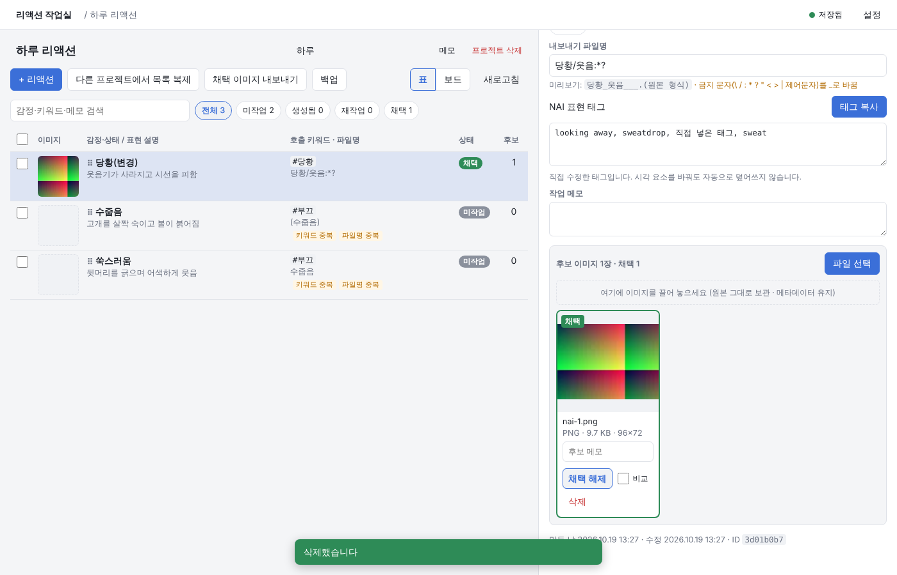
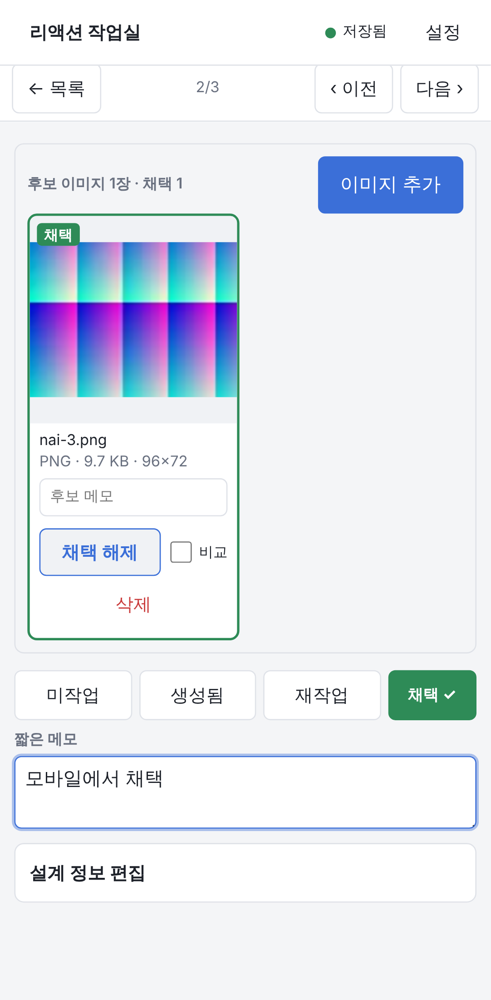
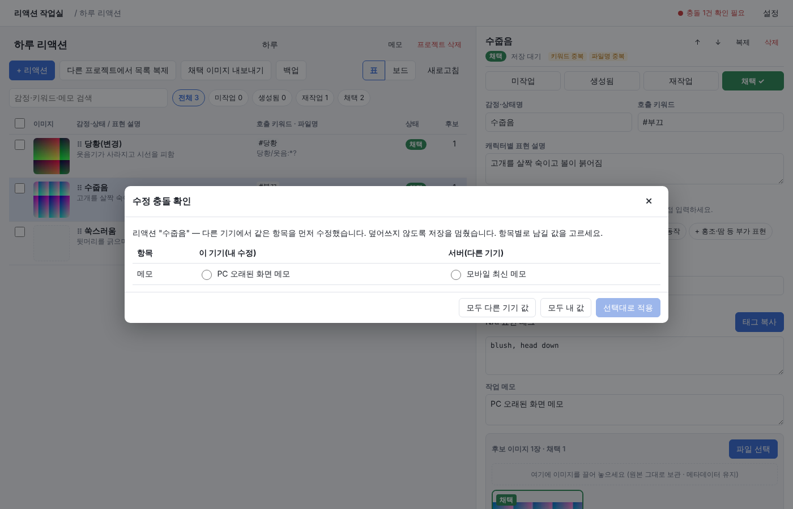

# 리액션 작업실 (NAIassembly)

NovelAI V5로 AI 캐릭터 채팅용 **리액션 이미지**를 만들 때 쓰는 개인용 웹앱입니다.
리액션 설계 → 태그 복사 → (NAI에서 직접 생성) → 후보 이미지 등록·비교·채택 → 지정 파일명 ZIP 내보내기까지 한 흐름으로 관리합니다.

- 앱 코드: 이 GitHub 저장소 → GitHub Pages로 배포
- 작업 데이터·이미지: **Supabase**(별도 저장 서비스)의 내 계정 전용 공간. Git 저장소에는 들어가지 않습니다.
- 앱은 AI API·NovelAI에 접속하지 않습니다(로그인·생성 자동화 없음).

| PC: 설계·후보 | 모바일: 한 리액션 중심 | 충돌 방지 |
|---|---|---|
|  |  |  |

(스크린샷은 자동 테스트가 만든 화면이며, 이미지는 테스트용 색 패턴입니다.)

---

## 1. 무엇을 할 수 있나

**프로젝트**(캐릭터 단위): 프로젝트명·캐릭터명·메모, 생성일·수정일, 리액션 목록.

**리액션**마다 아래 값을 따로따로 저장합니다. 감정명을 바꿔도 다른 값은 바뀌지 않으며, 리액션은 이름과 무관한 고유 ID로 관리합니다.

| 항목 | 설명 |
|---|---|
| 감정·상태명 | 예: 당황 |
| 캐릭터별 표현 설명 | 예: 웃음기가 사라지고 시선을 피함 |
| 시각 요소 | 눈·눈썹 / 입 / 시선 / 고개·자세 / 손동작 / 홍조·땀 등 / 기타. 각 줄에 한국어 설명과 NAI 태그를 따로 입력 |
| NAI 표현 태그 | 직접 편집 가능한 텍스트 |
| 호출 키워드, 내보내기 파일명, 작업 메모 | 각각 별도 값 |
| 진행 상태 | 미작업 · 생성됨 · 재작업 · 채택 |
| 후보 이미지 | 여러 장, 장마다 메모·원본 파일명·형식·크기·해상도·SHA-256 보관. 채택은 한 장 |

주요 기능

- 리액션 추가·수정·삭제·복제·순서 변경(PC는 끌어 놓기, ↑↓ 버튼), 여러 개 선택 후 상태 변경·삭제·비교·내보내기
- 다른 프로젝트에서 리액션 목록 복제(새 ID로 복사, **이미지·진행 상태는 기본 제외**, 선택하면 포함 가능)
- 감정명·키워드·메모(및 표현 설명·태그·파일명) 검색, 상태별 필터, 전체·상태별 개수
- 같은 호출 키워드·같은 내보내기 파일명은 목록에 **중복** 표시. 의미가 겹치는 리액션(수줍음/쑥스러움 등)은 목록에 설명·키워드를 같이 보여 주고, 여러 개 선택 → **나란히 비교**로 판단할 수 있습니다(AI 판정 없음).
- **선택 항목 라이브러리**(설정 → 선택 항목): 표정·몸짓을 한국어 설명 + 태그로 저장해 두고 리액션에서 골라 씁니다. 리액션에 들어간 값은 복사본이라 그 리액션에서만 고칠 수 있습니다. 처음엔 비어 있고, 원하면 “예시 항목으로 시작하기”를 누를 수 있습니다(예시 태그는 **검증되지 않은 출발점**으로 안내).
- **태그 자동 조립과 덮어쓰기 방지**: 시각 요소의 태그를 순서대로 중복 없이 이어 붙입니다. 태그를 직접 고친 뒤에는 시각 요소를 바꿔도 자동으로 덮어쓰지 않고, “빠진 태그만 추가 / 시각 요소 기준으로 바꾸기 / 그대로 두기”를 고르게 합니다.
- **태그 복사**: 복사 직전 최종 텍스트를 확인·수정하는 창이 뜹니다. 여기서 고친 내용은 원할 때만 리액션에 저장됩니다.
- **이미지 등록**: PC는 파일 선택·끌어 놓기, 모바일은 기기의 이미지 선택. 원본은 **재인코딩 없이 그대로** 올리고(메타데이터 유지), 목록용 썸네일은 별도 파일로 만듭니다. 형식은 파일 앞부분 바이트로 판별합니다(PNG·JPEG·WEBP·GIF·AVIF).
- 업로드는 대기 → 업로드 중 → 완료/실패로 표시하고, 실패하면 다시 시도할 수 있습니다. 서버에 파일과 기록이 **모두** 저장된 뒤에만 완료로 표시합니다. 업로드 전 파일은 기기(IndexedDB)에 보관해 새로고침 후에도 재시도할 수 있습니다.
- 확대 보기(화면 맞춤/원본 크기, 좌우 이동·스와이프), 최대 4장 나란히 비교, 채택·채택 변경·채택 해제
- 삭제 실수 방지: 이미지가 있는 리액션·채택 이미지 삭제는 확인 창에 “삭제”를 입력해야 실행, 프로젝트 삭제는 프로젝트명 입력
- **채택 ZIP 내보내기**: 전체 또는 선택한 리액션, 파일명 미리보기, 한국어 파일명, 실제 형식 확장자, 금지 문자·경로 문자·Windows 예약 이름·길이 처리, 중복 이름은 `_2`처럼 번호를 붙여 덮어쓰기 방지. 내보내기 직전 원본을 등록 당시 SHA-256과 대조해 다르면 중단합니다.
- **프로젝트 백업·복원**: 설계 데이터 + 후보 이미지 원본을 버전 있는 ZIP(`backup.json` + `images/`)으로 저장. 복원은 파일 전체를 먼저 검사하고(형식·버전·이미지 해시) 이상이 없을 때만 **항상 새 프로젝트로** 만듭니다. 도중에 실패하면 만든 것을 지워 되돌리므로 기존 프로젝트는 건드리지 않습니다.
- **저장 공간 점검**(설정): 기록 없이 남은 파일(업로드 중단·삭제 실패) 찾기·정리, 사용량 확인

### 상태 규칙

- 첫 이미지를 등록하면 미작업 → **생성됨**(서버 트리거)
- 이미지를 채택하면 **채택**. 채택 상태와 채택 이미지는 DB 제약으로 항상 함께 존재합니다.
- 채택 이미지를 지우면 채택이 해제되어 생성됨(남은 후보가 없으면 미작업)
- 채택된 리액션을 미작업/생성됨/재작업으로 바꾸면 확인 후 채택 해제(이미지는 남음)
- 다른 리액션의 이미지를 채택하는 것은 DB에서 거부

### 저장·동기화·충돌

- 편집하면 0.7초 뒤 자동 저장. 저장 전 내용은 기기(localStorage)에 임시 보관되어 새로고침·앱 종료 후에도 남습니다.
- 상단 표시: 저장됨 / 저장 중 / 저장 실패 n건 / 충돌 n건 / 업로드 n건 / 오프라인. 누르면 자세한 상태와 “실패 항목 다시 시도”.
- 모든 프로젝트·리액션에 **버전 번호**가 있어, 오래된 화면에서 저장하면 서버가 거부합니다. 서로 다른 항목을 고쳤으면 자동으로 합치고, **같은 항목을 다르게 고쳤으면 저장을 멈추고 항목별로 남길 값을 고르는 창**을 띄웁니다.
- 다른 기기의 변경은 화면으로 돌아올 때와 30초마다, 또는 “새로고침” 버튼으로 받아옵니다(실시간 푸시는 아님).

---

## 2. 저장 서비스 선택과 비용

**Supabase 무료(Free) 플랜**을 사용합니다. 인증(Auth)·데이터베이스(Postgres, 행 단위 보안 RLS)·파일 저장(Storage)을 한 곳에서 제공해, 서버 코드 없이 GitHub Pages의 정적 앱에서 “소유자만 접근”을 저장 서비스 규칙으로 강제할 수 있습니다.

2026-10-19 기준, Supabase 공개 저장소의 요금표 데이터([plans.ts](https://github.com/supabase/supabase/blob/master/packages/shared-data/plans.ts))로 확인한 무료 플랜 조건입니다(이 작업 환경에서는 supabase.com 접속이 막혀 있어 공식 요금 페이지를 직접 열지는 못했습니다. 가입 전에 https://supabase.com/pricing 에서 한 번 더 확인하세요).

| 항목 | Free | 참고 |
|---|---|---|
| 월 요금 | $0, 결제 수단 불필요 | |
| 데이터베이스 | 500 MB | 텍스트 데이터만 들어가므로 충분 |
| 파일 저장 | **1 GB** | NAI PNG 1장 ≈ 1~2 MB → 원본 약 500~1,000장 + 썸네일 |
| 전송량(egress) | 5 GB + 캐시 5 GB / 월 | 썸네일 위주로 보여 주고 원본은 확대·내보내기 때만 받음 |
| 활성 프로젝트 | 2개 | |
| 일시 정지 | **1주일 동안 사용하지 않으면 일시 정지** | 데이터는 보존. 대시보드에서 Restore 하면 다시 사용 |

Pro 플랜은 월 $25부터이며(파일 100 GB 포함, 초과 GB당 $0.0213, 일시 정지 없음) **이 앱은 유료 기능을 쓰지 않습니다.** 유료 전환·결제 수단 등록은 하지 않았습니다. 1 GB가 차면 백업을 받은 뒤 오래된 프로젝트를 지우거나, 그때 Pro 전환을 직접 판단하세요.

다른 후보: Firebase는 2024-10-30 이후 새 프로젝트의 Cloud Storage가 종량제(Blaze, 결제 수단 등록 필요) 요금제를 요구하므로 제외했습니다([Firebase FAQ](https://firebase.google.com/docs/storage/faqs-storage-changes-announced-sept-2024)).

### 보안 구조

- 앱(프런트엔드)에는 **공개용 키(Publishable 또는 anon)** 만 들어갑니다. 이 키는 공개되어도 되는 값이며, 접근은 아래 규칙이 막습니다. **secret / service_role 키는 앱·저장소 어디에도 넣지 마세요**(접속 설정 화면도 비밀 키를 거부합니다).
- 모든 테이블에 RLS: `owner_id = auth.uid()`인 행만 조회·생성·수정·삭제. 비로그인(anon)은 테이블 권한 자체가 없습니다.
- 다른 사람의 프로젝트에 리액션을 붙이거나, 남의 이미지 경로를 가리키는 기록을 만드는 것도 외래 키·검사 제약으로 막습니다.
- 이미지 버킷 `reaction-images`는 **비공개**이며, 저장소 정책으로 `<내 사용자 ID>/…` 폴더만 읽기·쓰기·삭제할 수 있습니다. 화면에는 1시간짜리 서명 URL로 표시합니다.
- 가입 기능을 꺼서 소유자 계정 하나만 존재하게 합니다(아래 3-3).

---

## 3. 설정 순서 (처음 한 번)

PC 브라우저에서 진행하세요. 소요 약 15분.

### 3-1. Supabase 프로젝트 만들기

1. https://supabase.com 에 가입·로그인합니다(GitHub 계정 로그인 가능).
2. **New project** → Organization 선택(없으면 만들기, 플랜은 **Free**).
3. Project name: 예) `naiassembly`, Database Password: 아무 강한 비밀번호(앱에는 필요 없음, 따로 보관), Region: **Northeast Asia (Seoul)** 권장.
4. **Create new project** 후 준비될 때까지 1~2분 기다립니다.

### 3-2. 데이터베이스·저장소 설정(SQL 한 번 실행)

1. 왼쪽 메뉴 **SQL Editor** → **New query**.
2. 이 저장소의 [`supabase/migrations/0001_init.sql`](supabase/migrations/0001_init.sql) 내용을 전부 복사해 붙여넣고 **Run**.
3. “Success. No rows returned”가 나오면 완료입니다. 여러 번 실행해도 안전합니다.
4. 확인: **Table Editor**에 `projects`, `reactions`, `candidates`, `visual_options`가 보이고, **Storage**에 `reaction-images` 버킷이 “Private”으로 보이면 됩니다.

### 3-3. 로그인 계정 만들기 + 가입 막기

1. **Authentication → Users → Add user → Create new user**
2. 이메일·비밀번호를 입력하고 **Auto Confirm User**를 체크한 뒤 만듭니다. (이 계정으로 PC와 모바일 모두 로그인합니다.)
3. **Authentication → Sign In / Providers**(메뉴 이름은 바뀔 수 있음)에서 **Allow new users to sign up**을 끕니다 → Save.
   - 앱에는 가입 화면이 없지만, 공개 키로 가입 API를 직접 부르는 것까지 막으려면 이 설정이 필요합니다. 가입이 열려 있어도 다른 사람이 내 데이터를 볼 수는 없지만(RLS), 내 저장 용량을 쓸 수는 있습니다.
4. (선택) **Authentication → URL Configuration**의 Site URL을 배포 주소(3-5)로 바꿉니다. 비밀번호 로그인에는 필수가 아닙니다.

### 3-4. 공개 키 확인

**Project Settings → API Keys**(또는 상단 **Connect**)에서

- **Project URL**: `https://xxxxxxxx.supabase.co`
- **Publishable key**: `sb_publishable_…` (없으면 Legacy 탭의 **anon public** 키)

두 값을 메모합니다. `secret`/`service_role` 키는 쓰지 않습니다.

### 3-5. GitHub에 값 등록 + Pages 켜기

1. 저장소 **Settings → Secrets and variables → Actions → Variables 탭 → New repository variable**
   - `VITE_SUPABASE_URL` = Project URL
   - `VITE_SUPABASE_PUBLISHABLE_KEY` = Publishable(또는 anon) key
   - 두 값은 공개되어도 되는 값이라 Variables에 넣습니다(Secrets에 넣어도 동작하지 않으니 Variables로).
2. **Settings → Pages → Build and deployment → Source: GitHub Actions** 선택.
3. 이 작업 브랜치(`claude/gifted-fermat-w0sqxw`)를 **main에 병합**합니다(Pull request → Merge). main에 올라가면 `.github/workflows/deploy.yml`이 자동으로 검사(타입·단위 테스트) → 빌드 → 배포합니다.
   - 이미 main이라면 **Actions → GitHub Pages 배포 → Run workflow**로 직접 실행할 수 있습니다.
4. 완료 후 주소: `https://m1nch0wh4ck.github.io/NAIassembly/`
5. 그 주소를 PC와 휴대폰에서 열어 3-3의 계정으로 로그인합니다. 휴대폰은 브라우저의 “홈 화면에 추가”를 쓰면 편합니다.

> Variables를 넣기 전에 배포하면 앱이 “접속 설정” 화면을 보여 줍니다. 그 화면에 URL·공개 키를 넣으면 그 기기에서만 임시로 동작합니다. 값을 넣은 뒤 Run workflow로 다시 배포하면 됩니다.

### 3-6. 첫 사용 확인(약 5분)

1. PC에서 새 프로젝트 → 리액션 1개 → 이미지 1장 등록 → 채택.
2. 휴대폰에서 같은 프로젝트를 열어 이미지가 보이는지, 태그 복사가 되는지 확인.
3. 휴대폰에서 이미지 1장 추가 → PC에서 새로고침해 보이는지 확인.
4. 내보내기 ZIP의 이미지를 NAI의 이미지 불러오기(또는 PNG 메타데이터 뷰어)에 넣어 생성 정보가 남아 있는지 확인.
5. 프로젝트 **백업**을 한 번 받아 두기.

---

## 4. 로컬 실행(개발)

Node.js 22 이상.

```bash
npm ci
cp .env.example .env.local   # 값 채우기(선택: 비워 두면 화면에서 입력)
npm run dev                  # http://localhost:5173
npm run typecheck && npm test && npm run build
```

환경 변수

| 이름 | 값 | 비고 |
|---|---|---|
| `VITE_SUPABASE_URL` | Supabase Project URL | 공개 값 |
| `VITE_SUPABASE_PUBLISHABLE_KEY` | Publishable(또는 anon) 키 | 공개 값. `VITE_SUPABASE_ANON_KEY`도 인식 |

`.env*`는 `.gitignore`에 있어 커밋되지 않습니다.

## 5. 파일 구성

| 경로 | 역할 |
|---|---|
| `supabase/migrations/0001_init.sql` | 테이블·제약·트리거·RLS·비공개 버킷·저장소 정책 |
| `src/data/store.ts` | 상태, 자동 저장, 버전 확인·3방향 병합, 기기 임시 저장 |
| `src/data/uploads.ts` | 업로드 대기열(원본 그대로 + 썸네일, 재시도, IndexedDB 보관) |
| `src/data/transfer.ts` | 내보내기·백업·복원·목록 복제·저장 공간 점검·서명 URL |
| `src/lib/*` | 파일명 정리, 형식 판별, 해시, 태그 조립, 병합, ZIP, 백업 형식 |
| `src/ui/*` | 화면(PC·모바일) |
| `tests/lib.test.ts` | 단위 테스트(`npm test`) |
| `tests/db/` | 마이그레이션·RLS 검증(Docker Postgres) |
| `tests/e2e/` | 로컬 Supabase 호환 스택, API·브라우저 E2E |
| `.github/workflows/deploy.yml` | GitHub Pages 배포 |

백업 형식(v1): ZIP 안에 `backup.json`(`format: "nai-reaction-studio-backup"`, `formatVersion: 1`, 프로젝트·리액션·후보 메타데이터와 SHA-256)과 `images/<후보ID>.<확장자>`(원본 바이트). 앞으로 형식을 바꾸면 `formatVersion`을 올리고, 앱은 자기보다 새 버전의 백업을 거부합니다.

---

## 6. 검증 결과

2026-10-19, 이 저장소의 코드로 실행한 결과입니다.

### 6-1. 단위 테스트 — `npm test` : 19/19 통과
파일명 금지 문자·경로·예약어·NFC·길이·중복 번호, 형식 판별, 태그 조립과 수정 보존, 3방향 병합, ZIP(UTF-8 파일명 플래그, 원본 바이트·PNG 메타데이터 유지, 경로 탈출 거부), 백업 왕복·손상·누락·미래 버전·다른 파일 거부·채택 불일치 보정.

### 6-2. DB 접근 제어 — `npm run test:db` : 26/26 통과
Docker Postgres 16에 Supabase와 같은 `auth.uid()`·`storage.foldername()` 정의를 두고 실제 마이그레이션을 두 번 적용한 뒤 역할을 바꿔 가며 검사: 다른 사용자의 조회·수정·삭제·남의 폴더 업로드·남의 이미지 경로 참조·남의 프로젝트에 리액션 생성 거부, 비로그인 차단, 상태·채택 일관성 제약과 트리거, 오래된 버전 저장 0행, 연쇄 삭제.

### 6-3. 실제 Supabase 구성요소 API 테스트 — `npm run test:api` : 25/25 통과
GoTrue(인증, supabase/auth 소스 빌드)·PostgREST v12.2.12·Supabase Storage API v1.25.7을 로컬에서 띄우고 앱과 같은 supabase-js로 검사: 가입 비활성화, 원본 업로드→다운로드·서명 URL의 SHA-256 동일 및 PNG tEXt 메타데이터 유지, B 사용자가 A의 행·이미지·서명 URL·덮어쓰기·삭제·폴더 목록 접근 불가, 공개 URL 접근 불가.

### 6-4. 브라우저 E2E — `npm run test:browser` : 59/59 통과
Chromium으로 PC(1400×900) 화면과 모바일(Pixel 7 에뮬레이션, 터치) 화면을 **두 기기**로 동시에 사용:
- 빈 화면 안내 → 프로젝트·리액션 설계, 새로고침 후 유지, 감정명 변경 시 다른 값 유지, 키워드·파일명 중복 표시
- 시각 요소 → 태그 자동 조립, 직접 수정한 태그는 덮어쓰지 않음, 빠진 태그만 추가
- PC 이미지 2장 등록 → 생성됨 → 채택 → 채택 변경 → 채택 이미지 삭제 시 채택 해제
- 모바일: 복사 전 수정한 태그가 클립보드에 복사됨, 이미지 선택 등록·썸네일 표시, 채택, 메모, 다음 리액션 재작업 표시
- PC에서 새로고침 → 모바일의 이미지·채택·메모·재작업이 이어짐
- 두 기기가 같은 메모를 고치면 오래된 화면 저장이 멈추고 충돌 창 표시, 고른 값이 저장됨
- 목록 복제: 상태·이미지 제외, 복제본 수정이 원본에 영향 없음
- 채택 ZIP: 금지 문자 파일명 정리, 한국어 파일명, 중복 이름 `_2`, **원본 바이트(SHA-256) 및 PNG 메타데이터 동일**, 선택 내보내기
- 백업 → 손상 백업·다른 ZIP 거부(프로젝트 수 변화 없음) → 정상 백업 복원 시 설계·태그·시각 요소·후보·채택·원본 해시·원본 파일명 유지, 새 프로젝트로 추가
- 다른 사용자 로그인: 소유자의 프로젝트가 보이지 않고 주소로 열어도 내용 없음
- 업로드를 네트워크 실패로 만들면 ‘실패’로 표시(완료로 표시 안 함) → 다시 시도로 완료

로컬 E2E 재현 방법(Docker 필요, 개발자용):
```bash
# SB_DIR에 gotrue(supabase/auth 빌드), postgrest(v12 바이너리), storage(supabase/storage v1.25.7, npm ci && npm run build) 준비
SB_DIR=/path/to/sb LOG_DIR=/tmp/nra-stack tests/e2e/stack.sh
DIST=/tmp/nra-dist tests/e2e/rebuild.sh && npx vite preview --outDir /tmp/nra-dist --port 4173 &
npm run test:api && npm run test:browser
```

### 6-5. 아직 검증하지 못한 것(외부 설정이 필요)

- **실제 Supabase 클라우드 프로젝트**에서의 동작: 위 검증은 같은 오픈소스 구성요소를 로컬에서 띄운 것입니다. 3-2의 SQL은 Supabase 대시보드 SQL Editor에서 실행하도록 작성했지만 실제 클라우드에서는 실행해 보지 못했습니다. 3-6 순서로 한 번 확인해 주세요.
- **GitHub Pages 실제 배포**: 워크플로 파일만 작성했습니다(Actions 실행과 Pages 설정은 저장소 설정 후 가능).
- **실기기 모바일**: 에뮬레이션(Chromium)으로만 확인했습니다. iOS Safari는 확인하지 못했습니다.
- **실제 NovelAI PNG**: NAI처럼 tEXt 메타데이터가 들어 있는 PNG를 만들어 검증했습니다. 실제 NAI 이미지로는 3-6의 4번으로 확인해 주세요.

## 7. 남은 제한

- 모바일 사진 앱에 저장한 뒤 고르면, 휴대폰·앱에 따라 기기가 파일을 변환(예: HEIC→JPEG, 메타데이터 제거)해서 브라우저에 넘길 수 있습니다. 앱은 받은 파일을 그대로 보관할 뿐이므로, 메타데이터가 중요하면 **파일 앱(다운로드 폴더)에서 원본 PNG를 고르세요.** 카드의 형식·크기로 확인할 수 있습니다.
- 다른 기기의 변경은 실시간 푸시가 아니라 화면 복귀·30초 주기·새로고침 때 반영됩니다. 같은 항목을 동시에 고치면 충돌 창이 뜹니다. 후보 이미지 메모는 버전 확인 없이 마지막 저장이 남습니다.
- 오프라인: 텍스트 편집은 기기에 임시 보관 후 연결되면 저장하지만, 새 프로젝트·리액션 만들기와 이미지 업로드·보기는 연결이 필요합니다. 업로드 대기 파일은 기기에 보관되어 나중에 재시도할 수 있습니다.
- 백업·내보내기 ZIP은 브라우저 메모리에서 만듭니다. 이미지가 수백 장(수백 MB)이면 PC에서 하는 것을 권장합니다.
- Supabase Free: 저장 1 GB, 1주일 미사용 시 일시 정지(대시보드에서 Restore). 정지 상태에서는 앱이 “서버 연결 확인 필요”를 표시합니다.
- 이미지 형식은 PNG·JPEG·WEBP·GIF·AVIF, 한 장 50 MB까지(Free 플랜 상한).
- 비밀번호 재설정 화면은 없습니다. Supabase 대시보드 Authentication → Users에서 바꾸세요.
- 이번 범위에서 제외: 협업·공개 갤러리·AI 자동 태깅·이미지 편집·NovelAI 자동 생성.
